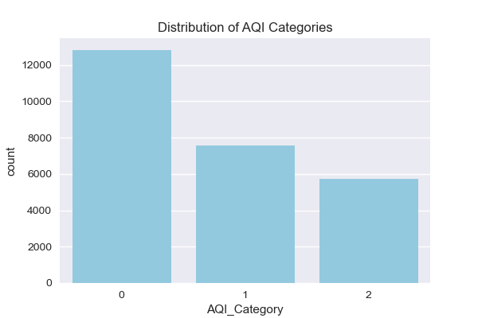
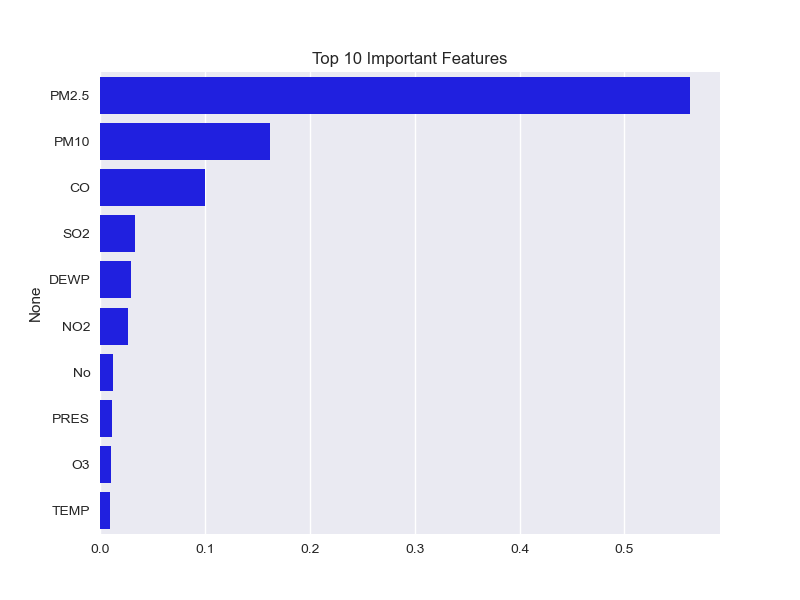
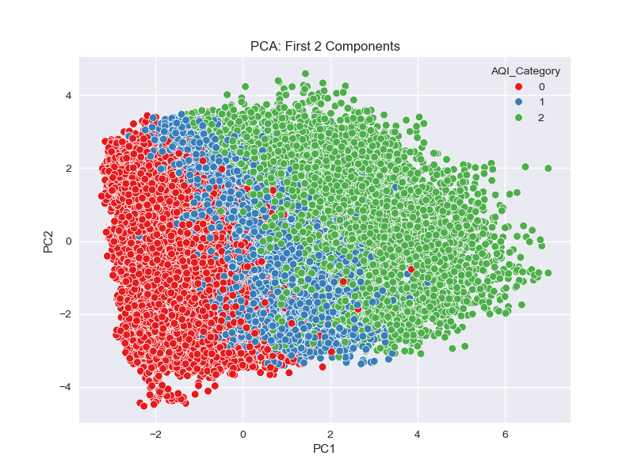
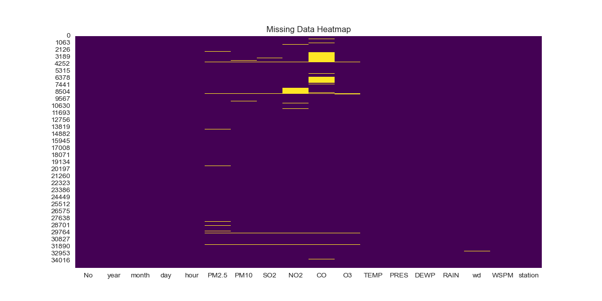
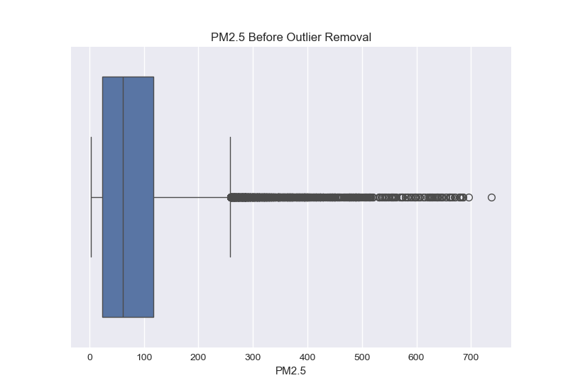

# Air-Quality_Prediction_System
# PG191 AIML Project
# Beijing Air Quality Prediction Pipeline

## Overview
This project focuses on building a complete **data processing and analysis pipeline** for the Beijing Multi-Site Air Quality dataset. The pipeline integrates **data preprocessing, target creation, feature selection, dimensionality reduction (PCA), and exploratory data analysis (EDA)** into a single workflow. The output is a ready-to-use dataset for machine learning tasks predicting Air Quality Index (AQI) categories.

---

## Dataset
- **Source:** [UCI Machine Learning Repository](https://archive.ics.uci.edu/ml/datasets/Beijing+Multi-Site+Air-Quality+Data)
- **Period:** March 2013 – February 2017
- **Key Features:** PM2.5, PM10, SO2, NO2, CO, O3, TEMP, PRES, DEWP, RAIN, WSPM, WD (wind direction)
- **Target Variable:** `AQI_Category`
  - 0 → Good (0–50)
  - 1 → Moderate (51–100)
  - 2 → Unhealthy (101+)

---

## Group Member Roles
- **Member 1:** Data cleaning, outlier handling, missing value treatment
- **Member 2:** Target creation, encoding categorical features
- **Member 3:** Feature selection, PCA, EDA visualizations
- **Member 4:** Integration into group pipeline, final CSV preparation

---

An end-to-end notebook project for preparing Beijing air-quality observations, exploring pollutant patterns, and creating an AQI-style category from PM2.5. The repository brings data cleaning, feature engineering, feature ranking, PCA, and visual analysis into one documented workflow.

> **Project status:** this repository contains a data-preparation and exploratory analysis pipeline. It does not currently contain a validated predictive model, saved predictions, or test-set evaluation metrics. The Random Forest in the notebooks is used for feature-importance ranking only; see [Modeling status and important caveat](#modeling-status-and-important-caveat).

## At a glance

| | |
|---|---|
| **Data** | Dongsi station, Beijing; hourly observations from March 2013 to February 2017 |
| **Source** | [Beijing Multi-Site Air-Quality Data — UCI Machine Learning Repository](https://archive.ics.uci.edu/dataset/501/beijing+multi+site+air+quality+data) |
| **Raw records** | 35,064 rows |
| **Records after IQR filtering** | 26,125 rows (25.5% removed) |
| **Target** | `AQI_Category`, derived from PM2.5 thresholds |
| **Tools** | Python, pandas, NumPy, scikit-learn, Matplotlib, Seaborn, Jupyter |

## What the pipeline does

1. **Inspect missingness** across pollutant, weather, and time fields.
2. **Impute missing numeric values** with each column's median; fill categorical values with the mode before encoding.
3. **Filter outliers** by retaining rows within 1.5 × IQR for every numeric column. This removes a substantial share of observations, so it is a consequential modeling choice.
4. **Create the target** from PM2.5 using the project's thresholds: `0` for ≤50, `1` for >50 and ≤100, and `2` for >100.
5. **Standardize numeric columns** using `StandardScaler` and one-hot encode `wd` and `station`.
6. **Rank features** with a Random Forest (`random_state=42`) and retain the top ten.
7. **Explore dimensionality reduction** with PCA, keeping five components and plotting the first two.

The notebooks save intermediate tables under `results/outputs/` and figures under `results/eda_visualizations/`.

## Visual results

### PM2.5-defined category distribution

The cleaned dataset contains 12,827 `Good`, 7,572 `Moderate`, and 5,726 `Unhealthy` records under the project thresholds.



### Feature importance ranking

The Random Forest ranks PM2.5 highest, followed by PM10 and CO. These are **in-sample feature importances**, not evidence of predictive accuracy. PM2.5 is also used to construct the target, creating direct target leakage if used as a predictor.



### PCA view

The first two principal components explain about **66.2%** of variance (35.5% + 30.7%). PCA is fit on the selected features in the notebook; this plot is an exploratory projection, not a model evaluation.



### Data quality and preprocessing

| Missing values before imputation | PM2.5 before and after IQR filtering |
|---|---|
|  |  |
| Missingness was concentrated in pollutant measurements, especially CO (3,197 rows) and NO2 (1,601 rows). | Rows were removed if any numeric column fell outside its IQR bounds. |

See `results/eda_visualizations/boxplot_pm25_after.png` for the corresponding PM2.5 plot after filtering, and the `pm25_*_scaling.png` images for the before/after scaling distributions.

## Dataset and target definition

The raw file included here is `data/raw/PRSA_Data_Dongsi_20130301-20170228.csv`. It contains date/time fields, pollutant concentrations (`PM2.5`, `PM10`, `SO2`, `NO2`, `CO`, `O3`), weather measurements, wind direction, and station metadata.

The target is a project-defined three-class label based on **PM2.5 concentration thresholds**. It should be described as a PM2.5-derived category in a portfolio or report; it is not a computation of the official multi-pollutant U.S. AQI. Check applicable local standards before interpreting the categories as public-health guidance.

## Repository layout

```text
.
├── data/
│   ├── raw/                 # Dongsi source CSV
│   └── external/
├── notebooks/               # Individual steps and integrated group pipeline
├── results/
│   ├── eda_visualizations/   # Figures displayed above
│   ├── logs/
│   └── outputs/              # Intermediate processed CSVs
├── environment.yml
└── README.md
```

## Reproducing the notebooks

The notebooks were authored in Jupyter using Python 3.10 and the dependencies listed in `environment.yml`.

1. Create an environment from the supplied Conda file: `conda env create -f environment.yml`.
2. Activate the environment named `myenv` and launch Jupyter: `jupyter lab`.
3. Open the notebooks in `notebooks/` and run the preprocessing steps in order: missing values → outlier removal → target creation → scaling → encoding → feature selection → PCA.

The integrated `Group_pipeline.ipynb` contains these steps together. Some notebooks include machine-specific absolute Windows paths; update those paths to point to `data/raw/PRSA_Data_Dongsi_20130301-20170228.csv` before rerunning in a different environment. The environment file also contains a machine-specific Conda prefix, so portability may require removing the `prefix` line or creating a fresh environment file for your platform.

## Modeling status and important caveat

There is no train/test evaluation in the supplied notebooks: no held-out predictions, confusion matrix, precision/recall, F1, or baseline comparison is saved. Accordingly, this README makes no accuracy claim and does not show a predictions-versus-actual chart; that chart cannot be produced faithfully without a trained model's predictions on data not used to fit it.

There is also **direct target leakage** in the current feature-selection workflow: `AQI_Category` is created from PM2.5, then PM2.5 remains in `X` when the Random Forest is fitted. Its very high importance is therefore expected and cannot establish that the model learned a useful forecasting signal. In addition, the notebooks appear to fit preprocessing and feature-selection steps before any train/test split, and the saved selected-feature CSV includes `No`, a row index-like field.

A sound next modeling step would be to define the prediction time horizon, split data before fitting imputers/scalers/feature selection (ideally chronologically for forecasting), exclude PM2.5 from inputs when predicting its threshold-derived label, and report held-out metrics plus a confusion matrix. If the actual goal is to forecast future PM2.5, define a future target (for example, PM2.5 at a stated lead time) and ensure every feature is available at prediction time.

## Credits

Course project: PG191 AIML Project. The repository includes an integrated group pipeline and notebooks for individual preprocessing and analysis steps. The dataset is from the UCI Machine Learning Repository; refer to its dataset page for citation and licensing details.

